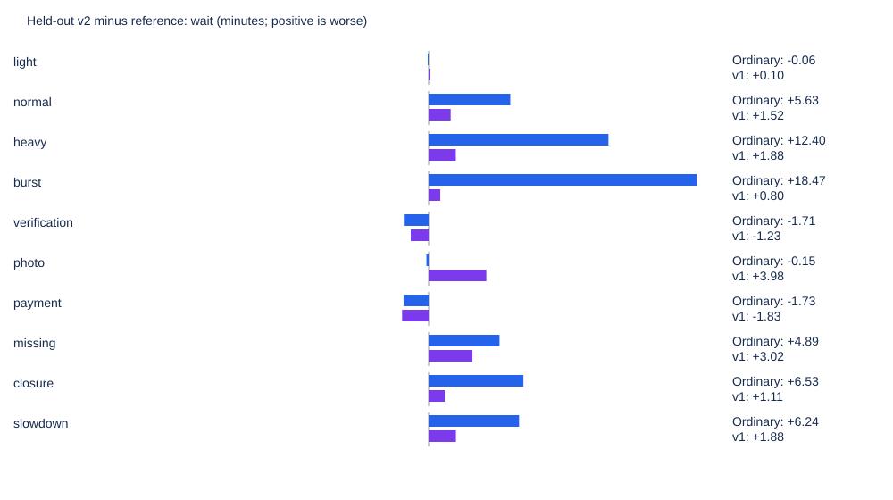
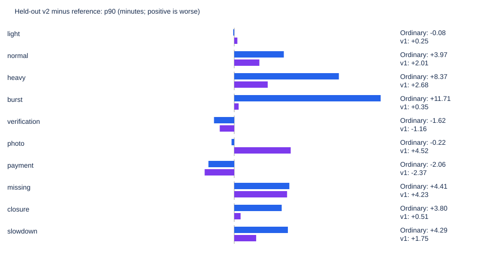

# Scheduling diagnosis and experimental v2

## Decision

**V2 remains experimental and is not recommended as a replacement.** Both tested candidates failed to establish an overall improvement. Existing Ordinary and Ordinary-versus-v1 defaults are unchanged. This pass implements and evaluates a plausible improvement hypothesis; the evidence rejects a general performance claim.

The original 104 tests pass (the first sandbox run hit existing pytest directory permissions; the authorized rerun passed). All original preset results reproduce exactly. No waiting-accounting, capacity or prerequisite bug was found; no baseline correction was needed. User databases/default storage were not changed. Browser tests use a separate `.local/scheduling-browser.sqlite3` database.

## What the evidence establishes

Controlled ablations hold workload, desks and disruption payloads fixed. In all three presets, turning off fairness changes neither waiting nor completion. V1 logs protection but selects the existing FCFS head every time: 53, 85 and 63 protected dispatches, **zero changed orders**. Retaining smart dispatch but using fixed routing exactly reproduces Ordinary. Thus routing, rather than dispatch/fairness, accounts for the measured preset gap. This finding is specific to these cases: preserved age can change dispatch following full-capacity reassignment elsewhere.

Normal Morning total queue waiting by service, in student-minutes:

| Service | Ordinary | V1 | V1 minus Ordinary |
|---|---:|---:|---:|
| Verification | 691.92 | 439.93 | -252.00 |
| Photo | 207.81 | 544.79 | +336.98 |
| Payment | 13.66 | 19.47 | +5.81 |
| Enrollment | 21.37 | 97.83 | +76.46 |

The net increase is 167.25 student-minutes / 40 = 4.18127 minutes per student. V1 shifts waiting away from verification into photo and enrollment. It routes 22 students photo→verification→payment→enrollment and 18 verification→payment→photo→enrollment; Ordinary routes all 40 verification→photo→payment→enrollment. Mean verification completion is 37.35 versus 37.96 simulated minutes (22.05 versus 22.66 minutes after arrival); mean final completion is 49.84 versus 54.02. Delaying verification is measurable but its small mean shift alone does not explain the entire final delay. Queues and sequencing interact downstream.

Follow-up ablations for Normal Morning (diagnostic interventions, not shipped policies):

| Routing/dispatch variant | Average wait (min) |
| Ordinary | 23.369 |
| v1 | 27.550 |
| v1-no-fairness | 27.550 |
| v1-fixed-routing | 23.369 |
| v1-prep-first | 27.550 |
| v1-verification-first | 22.254 |
| v1-mean-estimates | 27.291 |

Immediate preparation has no effect on this preset because its observed routing already prepares first. Forcing verification when eligible reduces waiting here; replacing v1's oracle estimates with means alone barely changes it. These follow-up ablations were recorded after the initial fixed-routing/fairness diagnosis; they were not used to retune the frozen candidate against held-out seeds. Neither a one-preset benefit nor this compound intervention proves a universal cause or recommendation.

V1 estimates `(sum of queued individual durations + sum of open busy residuals) / open desks + own duration`. This is a fluid workload approximation, not the actual FCFS start time: a free desk can accept a student immediately while the formula averages another desk's residual into its estimate. Closed desks are excluded, future-start multipliers scale queued/own durations, and already-started residuals remain exact. It uses known individual base requirements and actual scheduled finish times—an oracle assumption. Ordinary's routing/FCFS dispatch does not use service duration to choose students. No policy reads future arrivals or actions for routing; v1's advantage in information is explicitly disclosed.

Accounting check: per-student visit = queue waiting + preparation + actual service for completed default-engine runs. Event queue exits sum to authoritative total waiting. Preparation is an exclusive unstaffed timed activity and is not queue wait. Utilization differences arise from scheduling and observation windows, not deliberately idle baseline desks. Full tables are in `verification/scheduling/`: service-waits, task-orders, student-times, queue-growth (every settled event time), utilization and diagnosis CSVs.

## V2 algorithm and available information

Candidate: **estimated prerequisite head-start**, coefficient **1.0**. Routing and dispatch stay deterministic. Eligibility is unchanged. Use configured service-range means multiplied by the currently active multiplier, queue counts and open desk status. Estimate active residuals as max(0, configured mean × multiplier at service start − elapsed time); never inspect actual scheduled completion or individual required durations. Assign estimated queued jobs to the earliest available estimated desk slot, then estimate the arriving candidate's finish. Underestimation of long active services is an explicit limitation. Closed-but-finishing desks are excluded from new capacity. Future actions/arrivals are not read.

Score = estimated next completion + prerequisite penalty. Verification and payment have zero penalty. Photo gets one critical-task mean duration when verification or payment is eligible, so it wins only with a sufficiently shorter immediate estimated completion. For missing documents, photo gets the preparation mean as a penalty; immediate preparation wins. Ties use service enum order. This is a local head-start preference, **not** an estimate of optimal visit completion. After verification it may prioritize payment over photo; this is genuinely different from Ordinary and contributes to observed trade-offs. No queue hopping except existing full-capacity-unavailable reconsideration. FCFS and preserved-age protection remain intact; protection never overrides prerequisites or closed capacity.

Each v2 routing event records means, queued work, estimated desk loads, multiplier-adjusted duration, estimate, penalty, coefficient, score and rule. The UI describes these recorded scores. In readiness trials, v2 uses the same generic service means for verification attempts; the separate failed-check duration is simulated accurately but not used as a bespoke routing estimate. That conservative approximation is not benchmarked as a readiness optimization.

## Evaluation protocol and selection

See [the protocol](scheduling-protocol.md), written before development evaluation. Ten families × ten development seeds (100–109), disjoint from ten held-out seeds (200–209). Two candidate coefficients, 1 and 2, were tested on development only. Mean waits were 42.4300 and 42.7883 versus v1 41.1620 and Ordinary 37.5942. Coefficient 1 also had the lower candidate p90, so it was frozen for held-out evaluation. No retuning followed held-out results. 400 development runs took about 8 seconds; 300 held-out runs about 4 seconds. Runtime permits the full planned split.

All policies share each case's immutable workload and complete action payload. Original presets are separate, unchanged seed-42 demonstrations. Cases are weighted equally, which also weights the ten families equally. Primary metric is the mean of per-case average total queue wait; all runs completed, so the population is all students. Tail metrics are per-run nearest-rank p90 and maximum, then averaged across cases. No student-level pseudo-replication or confidence intervals. Wins/ties/losses use a 0.01-minute tolerance. Incomplete outcomes must remain explicit and are not ranked using completed-only averages.

Held-out summary (100 cases per policy, all complete):

| Policy | Mean wait | Mean p90 | Mean maximum | Mean visit | Mean makespan | Mean runtime (ms) |
|---|---:|---:|---:|---:|---:|---:|
| Ordinary | 36.95 | 66.94 | 74.17 | 48.98 | 126.06 | 7.55 |
| V1 | 40.88 | 68.92 | 75.71 | 52.91 | 126.23 | 10.54 |
| V2 | 42.00 | 70.19 | 76.86 | 54.03 | 127.35 | 12.44 |

V2 versus Ordinary: **29 wins / 1 tie / 70 losses**, +5.05 min mean wait (+13.67%). Versus v1: **30 / 0 / 70**, +1.12 min (+2.75%). Mean p90 is +3.26 and +1.28 min respectively. Single-pass runtime is indicative, not a controlled performance microbenchmark; v2 took about 18% more time than v1 here.

| Family | V2 − Ordinary mean wait | V2 − v1 mean wait | V2 − Ordinary p90 | V2 − v1 p90 |
|---|---:|---:|---:|---:|
| light | -0.06 | +0.10 | -0.08 | +0.25 |
| normal | +5.63 | +1.52 | +3.97 | +2.01 |
| heavy | +12.40 | +1.88 | +8.37 | +2.68 |
| burst | +18.47 | +0.80 | +11.71 | +0.35 |
| verification | -1.71 | -1.23 | -1.62 | -1.16 |
| photo | -0.15 | +3.98 | -0.22 | +4.52 |
| payment | -1.73 | -1.83 | -2.06 | -2.37 |
| missing | +4.89 | +3.02 | +4.41 | +4.23 |
| closure | +6.53 | +1.11 | +3.80 | +0.51 |
| slowdown | +6.24 | +1.88 | +4.29 | +1.75 |

V2 wins every verification- and payment-bottleneck case against both references, but loses every normal/heavy/missing case. Worst mean-wait regression versus Ordinary: burst seed 202, **+22.06 min**, p90 +19.49. Worst versus v1: photo seed 207, **+8.84 min**, p90 +9.80. The predeclared release gate (completion, ≥5% mean improvement over v1, no mean regression versus Ordinary, and constrained family/tail regressions) fails. Do not promote v2. Additional evidence would require a new declared development/held-out design, not repeated tuning on these held-out cases.




## Presets (average completed-student wait, minutes)

| Preset | Ordinary | V1 | V2 experimental |
|---|---:|---:|---:|
| Normal Morning | 23.37 | 27.55 | 28.34 |
| Arrival Rush | 35.09 | 44.92 | 45.84 |
| Disruption & Recovery | 24.82 | 31.12 | 31.38 |

All visits complete: 40/50/40 per policy. V2's disruption makespan is slightly shorter than v1 (91.45 vs 92.27) while its wait and tails are worse—another reason not to declare a universal winner. Unrounded metrics, counts, fairness dispatches and runtimes are in `presets.csv`.

## Identity, compatibility and commands

Legacy identifier `QueuePact` always means v1; its event stream is unchanged. UI displays QueuePact v1. New identifier `QueuePact v2` is experimental. New RunRecord schema 2 includes an explicit `policy_version`. Schema-1 records deserialize and reserialize unchanged, preserving fingerprints; no migration overwrites evidence. Unsupported policy-version pairs are rejected. Existing saved JSON was reconstructed in regression tests. Staffing, branches and readiness inherit their selected policy. Reports and metrics CSV identify it explicitly. `--policy both` remains Ordinary versus v1; `smart` remains a v1 alias.

```powershell
Set-Location 'C:\Users\KIIT0001\OneDrive\Documents\ChatGPT\QueuePact'
.\.venv\Scripts\python.exe -m pytest -q
.\.venv\Scripts\python.exe verification\benchmark_scheduling.py --mode diagnose
.\.venv\Scripts\python.exe verification\benchmark_scheduling.py --mode development
.\.venv\Scripts\python.exe verification\benchmark_scheduling.py --mode heldout
.\.venv\Scripts\python.exe verification\summarize_scheduling.py
.\.venv\Scripts\python.exe verification\browser_scheduling.py
.\.venv\Scripts\python.exe -m queuepact headless --policy v2
.\.venv\Scripts\python.exe -m queuepact ui --port 8088
```

Benchmark files are reproducible except measured wall-clock runtimes. Re-running does not authorize retuning. No raw per-run event dumps are retained; queue-growth diagnostics are compact tables. Browser verification uses installed Chrome and the existing optional verification requirements.

## Final checks

130 tests passed; pip check and compileall passed. Browser checks and limitations are recorded in `verification/README.md`. V2 completed in the live UI and both requested paired comparisons; saved JSON reproduced as version 2 and the report displayed the correct experimental identity. No console errors were captured. Native print/offline testing was not repeated in this focused pass.
